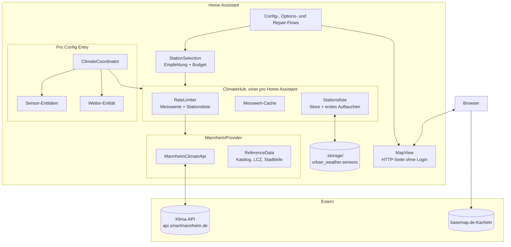
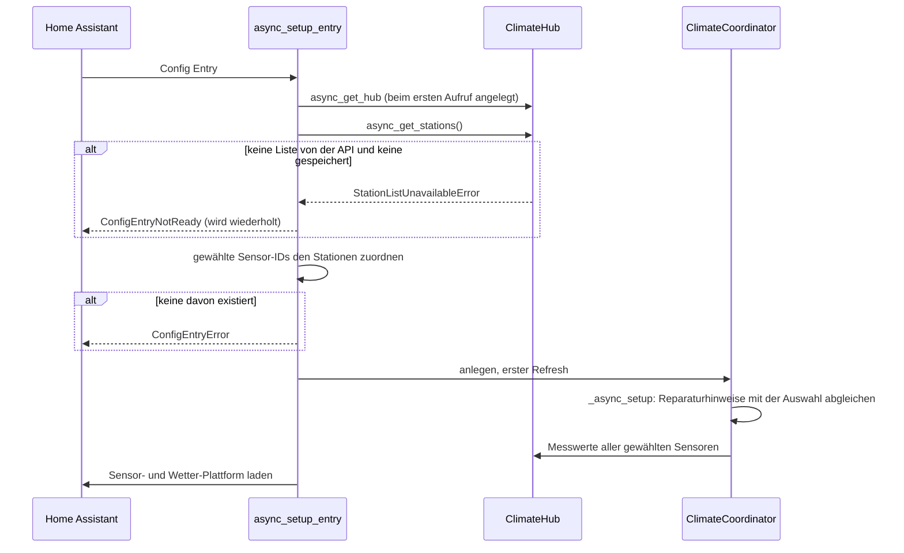
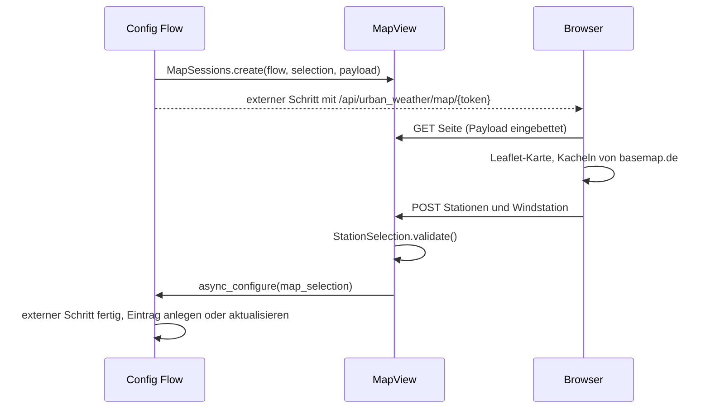

<!-- source: c69b9372b62bf1e023818e76d31c3f79eba77eb6 -->
# Architektur

Die Integration liegt in `custom_components/urban_weather/`. Die Konventionen für die
Arbeit daran (Befehle, Tests, Commits, Versionierung) stehen in
[`AGENTS.md`](https://github.com/CodeBrauer/ha-urban-weather/blob/main/AGENTS.md).

## Komponenten

| Modul | Aufgabe |
|---|---|
| `provider.py` | Interface `Provider`, Konfiguration `Network`, gemeinsame Typen (`ApiSensor`, `Measurement`) und Fehlertypen (`ApiRateLimitError`, `SensorNotFoundError`, …) |
| `providers/` | `async_create_provider()`, ein Paket pro Messnetz |
| `providers/mannheim/` | Messnetz `MANNHEIM` und `MannheimProvider`: HTTP-Client für `/sensors` und `/measurements/{id}` (`api.py`), Gruppieren der Sensoren zu Stationen (`stations.py`), mitgelieferter Metadatenkatalog, LCZ-Raster und Stadtteilnamen (`reference.py`, `data/`) |
| `hub.py` | Singleton `ClimateHub`: Rate-Limiter, Messwert-Cache, Stationsliste mit gespeicherter Kopie und Zeitpunkt des ersten Auftauchens |
| `stations.py` | `Station`, `recommend()` |
| `selection.py` | `StationSelection`: Empfehlung, Abfrage-Budget und Beschriftungen, gemeinsam für alle Flows und die Karte |
| `config_flow.py` | Config Flow (Standort, Umgebung, Stationen), Reconfigure, Options Flow |
| `map_view.py`, `www/` | Kartenseite als externer Schritt des Config Flows |
| `coordinator.py` | `ClimateCoordinator`: Abfragen, Nachholen, gehaltene Werte, Reparaturhinweise |
| `aggregation.py` | Plausibilität, Ausreißer, Mediane und abgeleitete Werte |
| `sensor.py`, `weather.py` | Entitäten; Schätzung des Wetterzustands |
| `repairs.py` | Fix-Flows für die Reparaturhinweise |
| `diagnostics.py` | Diagnose mit entfernten Koordinaten |
| `geo.py` | Entfernung, Richtung und Clustering ohne Home-Assistant-Imports (auch vom Build-Skript genutzt) |
| `const.py` | Intervalle und Schwellen, die für alle Messnetze gelten; die Limits eines Messnetzes stehen in seinem Provider |

## Provider

Hub, Stationsauswahl, Flows und Entitäten nutzen nur das Interface `Provider`. Eine
Provider-Klasse setzt eine Art von API um; ein Messnetz auf dieser API ist Konfiguration
(`Network`):

| `Network` | Wofür |
|---|---|
| `endpoint`, `fields` | Basis-URL und Feld-Zuordnung: Feldnamen des Messnetzes zu `Field` |
| `limits` | `RequestLimits`: Fenster der Rate-Limiter, dokumentierte und geplante Abfragen pro Stunde |
| `attribution`, `name`, `operator` | Quellenangabe und Geräteinfo der Entitäten |
| `area` | Titel eines Standorts ohne bekannten Stadtteil |
| `tiles` | Hintergrundkarte der Stationskarte |

Der Provider liefert die rohe Stationsliste (der Hub speichert sie unverändert) und baut
daraus die Stationen. Seine Basisklasse legt das Abfragemodell für Messwerte fest:

| Basisklasse | Messwerte | Abfragen pro Aktualisierung |
|---|---|---|
| `SensorProvider` | `async_get_measurements(sensor_id)`: ein Sensor pro Abfrage (Mannheim) | Eine pro Sensor |
| `BulkProvider` | `async_get_all_measurements(sensors)`: alle Sensoren in einer Abfrage; der Provider darf sie auf die übergebenen Sensoren filtern, z. B. nach Gebiet | Eine, egal wie viele Stationen |

Stationsauswahl und Kartenseite planen mit `requests_per_refresh()`, der Hub fragt je nach
Basisklasse ab ([Abfragen und API-Zugriff](data-flow.md)). Referenzdaten sind optional: Ohne sie geben `lcz()` und `district()` `None` zurück, und der
Flow nimmt `DEFAULT_ENVIRONMENT` und den `area` des Messnetzes.

## Einrichten eines Standorts

Sensoren werden nur für Werte angelegt, die ein gewählter Sensor misst (`parameters` des
API-Sensors). Änderungen an den Optionen laden den Eintrag neu (`OptionsFlowWithReload`).

## Kartenseite

Die Karte ist ein externer Schritt des Config Flows, ausgeliefert von Home Assistant selbst:

- Die Seite braucht kein Home-Assistant-Login, deshalb ist der Link ein nicht erratbares
  Token, das an den Flow gebunden ist und nach `MAP_SESSION_TTL` abläuft. Antworten werden
  nicht gecacht.
- Der Server prüft die Auswahl erneut; die Seite hilft nur, im Budget zu bleiben.
- `www/map.js` wiederholt die Budget-Regeln von `StationSelection`, um das Intervall live
  anzuzeigen. Die Kosten pro Aktualisierung kommen mit dem Payload (`budget.requests`), so
  folgt die Seite dem Abfragemodell des Providers. Ändere beide zusammen.
- Die Texte kommen aus dem Selector `map_page` in `strings.json`, in der Systemsprache.
- Leaflet liegt mitgeliefert in `www/leaflet/`; die statischen Dateien werden unter
  `STATIC_URL` mit einem Inhalts-Hash als Cache-Buster ausgeliefert.

## Config Entry

`VERSION = 1`, bisher ohne Migrationen. Änderungen an diesem Format brauchen eine Migration
(siehe [`AGENTS.md`](https://github.com/CodeBrauer/ha-urban-weather/blob/main/AGENTS.md#home-assistant-specifics)).

| Teil | Schlüssel | Inhalt |
|---|---|---|
| `unique_id` | | `"{latitude:.3f}_{longitude:.3f}"`, Standorte unter etwa 100 m Abstand sind also Duplikate |
| `data` | `latitude`, `longitude` | Standort |
| | `radius` | Suchradius in Metern (`DEFAULT_SEARCH_RADIUS_M`, höchstens `MAX_SEARCH_RADIUS_M`) |
| | `environment` | `dense`, `open_built`, `industrial` oder `green` (`Environment`) |
| `options` | `temperature_sensors` | API-Sensor-IDs der Temperaturstationen |
| | `wind_sensor` | API-Sensor-ID der Windstation oder `null` |
| | `scan_interval` | Aktualisierungsintervall in Minuten (`SCAN_INTERVAL_CHOICES_MIN`) |
| | `dew_point_offset` | Taupunkt-Korrektur in K |

Entitäten haben die Unique ID `{entry_id}_{key}` (`key` der Entity Description, `weather`
für die Wetter-Entität) und gehören zu einem Dienst-Gerät pro Eintrag. Ab 1.0.0 sind
Entitäts-IDs, Unique IDs und dieses Format stabil.

## Reparaturhinweise

| Issue-ID | Daten | Angelegt von |
|---|---|---|
| `station_offline_{entry_id}_{sensor_id}` | `entry_id`, `sensor_id` | Coordinator, keine gültigen Daten für `STATION_OFFLINE_AFTER` |
| `station_removed_{entry_id}_{sensor_id}` | `entry_id`, `sensor_id` | Coordinator, 404 von der API oder Sensor fehlt in der Stationsliste |
| `new_stations_{entry_id}_{Sensor-IDs mit - verbunden}` | `entry_id` | Coordinator, neue Sensoren in einer Empfehlung, die ins Budget passt |

Alle Hinweise sind behebbar und laufen über `StationRepairFlow`. Die ID eines Vorschlags
enthält seine Sensoren, ein ignorierter Vorschlag bleibt deshalb ignoriert, während ein
anderer neu erscheint. Hinweise zu Sensoren, die nicht mehr gewählt sind, werden beim Setup
gelöscht, alle Hinweise eines Eintrags, wenn er entfernt wird.
